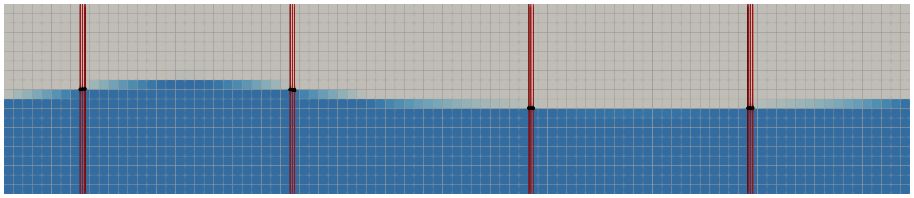
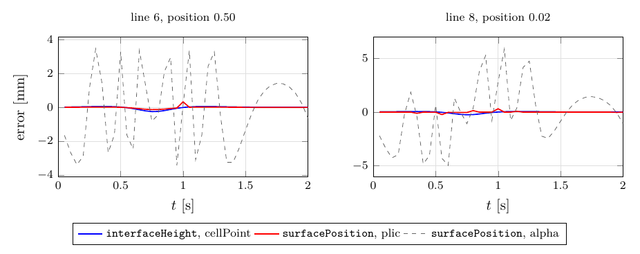
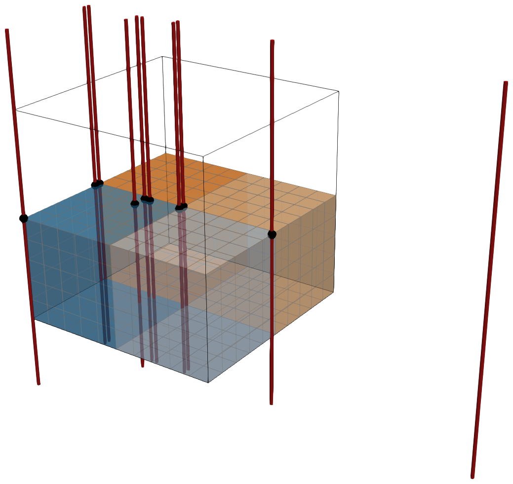
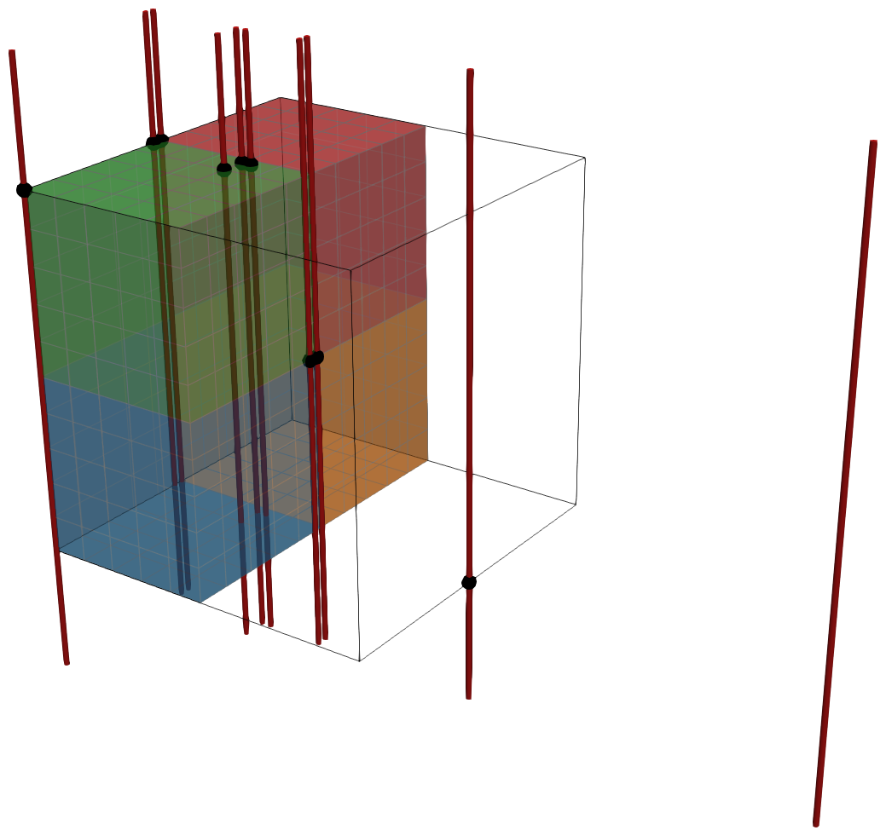
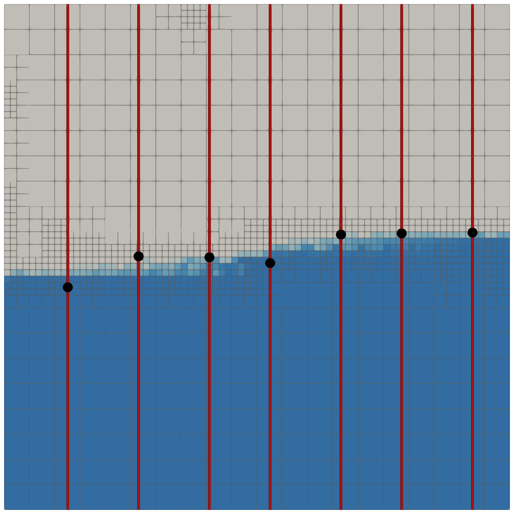
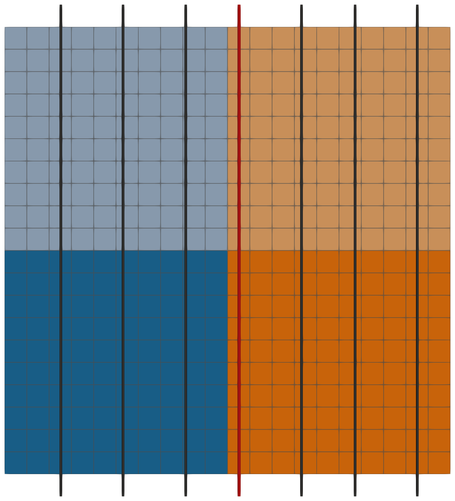
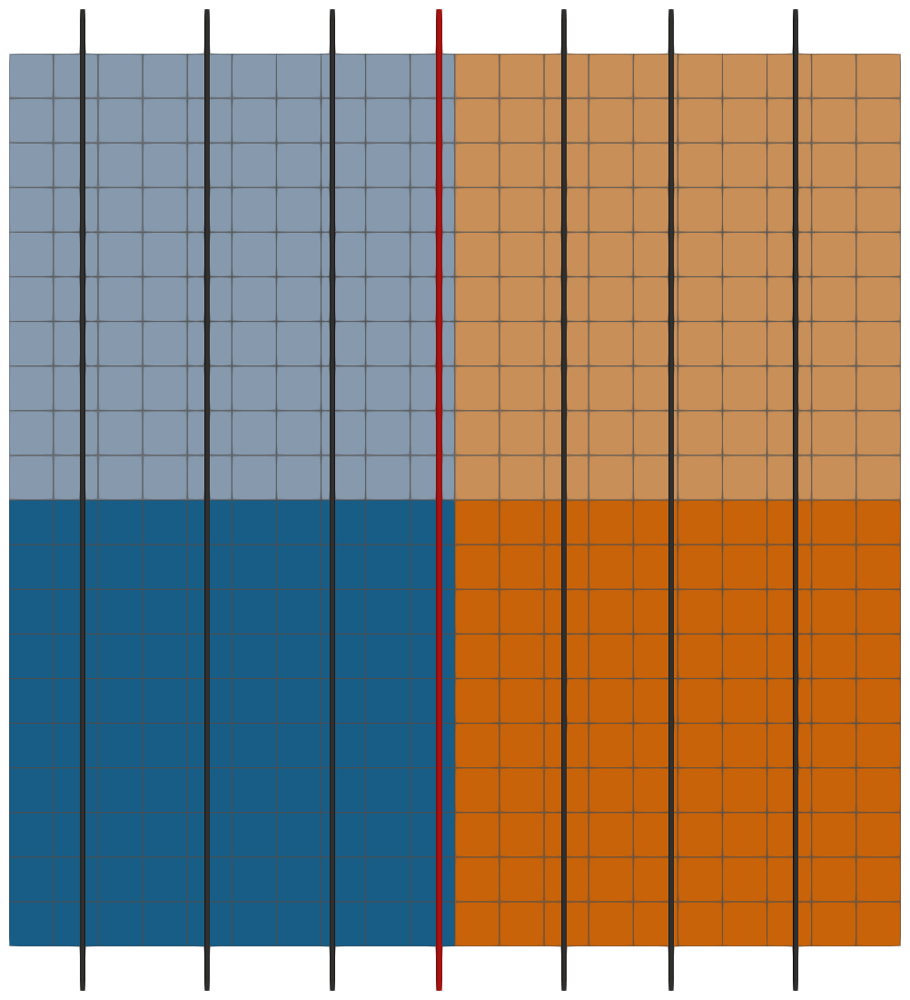
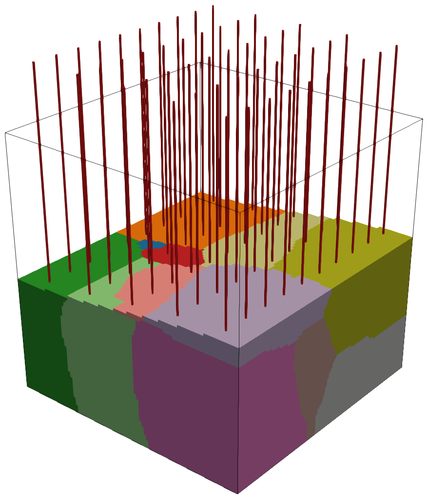

<!--
  Copyright (C) 2026 Johan Roenby
  SPDX-License-Identifier: GPL-3.0-or-later

  Written by test/report/makeReadme.py from test/report/README.md.in and the
  results of the executed test suite. Edit the template, not README.md.
-->

# surfacePosition

`surfacePosition` is an OpenFOAM (v2512) function object that reports the
height and position of a volume-of-fluid interface at a set of locations, with
the same entries and output as OpenFOAM's `interfaceHeight`, which integrates
the interpolated volume fraction along a sampled line. `surfacePosition` finds
the cells crossed by each line once and follows them through mesh changes by a
flood fill, so its cost per write does not depend on the mesh size, and it sums
the lengths of the line inside the liquid, cutting each interface cell
geometrically with the isosurface of the volume fraction.

This README is a Markdown version of the report
[test/report/report.pdf](test/report/report.pdf) on the implementation and the
test suite in [test](test). All numbers, tables and figures are generated from
the output of one run of the suite (wall time 1 min 44 s). In a
1 000 000-cell case on 18 processors, `surfacePosition` costs
5.2 ms per time step for 50 lines, against 1264 ms
for `interfaceHeight`; on the exact stream function wave it is more accurate
than `interfaceHeight` on the same mesh, and it is exact for flat interfaces,
also on faces and processor boundaries.

## Contents

1. [Motivation: `interfaceHeight`](#1-motivation-interfaceheight)
2. [Usage](#2-usage)
3. [Implementation](#3-implementation)
4. [Test suite](#4-test-suite)
5. [Findings of the tests](#5-findings-of-the-tests)
6. [Reproducing the tests and this README](#6-reproducing-the-tests-and-this-readme)
7. [License](#license)
8. [Author](#author)

## 1. Motivation: `interfaceHeight`

`interfaceHeight` was added to OpenFOAM by the OpenFOAM Foundation in May 2017
(OpenFOAM-6) and has been in OpenFOAM.com since v2006, which added the optional
`direction` entry. At every write, it builds for each location a
`midPointAndFaceSet` along the mesh diagonal through the location in the
direction, which points downwards (gravity), with a new `meshSearch`; it
integrates the volume fraction, interpolated to the sampled points (`cellPoint`
by default), along this line with the trapezoidal rule, and sums the result
over the processors. The algorithm is the same in all OpenFOAM.com releases
from v2006 to v2606; the only changes are the writing of the file headers
(removed in v2012, restored on the master processor in v2406) and the
documentation (v2512). The OpenFOAM Foundation corrected its parallel operation
in May 2023 (commit `1d78434bee`, OpenFOAM-11) by skipping sampling segments
between two faces; OpenFOAM.com does not have this correction.

The tests in this README, with OpenFOAM.com v2512, show the weaknesses of
`interfaceHeight`:

- *Cost.* The search tree of the mesh is built anew for every location at every
  write. In a 1 000 000-cell case on 18 processors,
  `interfaceHeight` costs 1264 ms per time step for 50
  locations, 173 % of the flow solution itself
  ([section 4.4](#44-cost-in-a-large-case)).
- *Parallel runs.* A line on a processor face or edge counts the liquid of the
  cells on all sides, e.g. twice the height on a processor face (table 3).
- *Cyclic patches.* A line on a cyclic patch gets half the liquid (table 3).
- *Locations far from the mesh.* The line has the length of the mesh diagonal
  around the location; for a location far above or below the mesh it does not
  reach the mesh, and the height is 0 (table 3).
- *Accuracy.* With `cell` interpolation the height is biased by a quarter of
  the cell height, with a sign that follows the direction
  (-10.0 mm on the medium wave mesh); with `cellPoint` it is
  unbiased, but less accurate than a geometric cut of the interface cells
  (table 1).

`surfacePosition` keeps the entries and output of `interfaceHeight`, so that it
can replace it directly, and addresses these points: the cells of each line are
found once and followed through mesh changes, so that its cost per write does
not depend on the mesh size (5.2 ms per step in the same case,
244 times less); cells covering the same part of a line, also on
processor and cyclic faces, are averaged; its lines cross the whole mesh
wherever the location is; and the liquid in the interface cells is measured
with the isosurface cut of the geometric VoF reconstruction.

## 2. Usage

`surfacePosition` is built into the library `libsurfacePosition` by
`./Allwmake` (with OpenFOAM v2512 sourced). It links OpenFOAM's
`finiteVolume`, `meshTools`, `sampling`, `lagrangian` and `geometricVoF`
libraries. It compiles with OpenFOAM.com v2006 and later
([section 4.5](#45-compatibility-with-openfoam-versions)). Its entries and
output are those of `interfaceHeight`, so that a
dictionary of `interfaceHeight` works after changing its `type` and `libs`, and
post-processing tools for `interfaceHeight` read its output:

```
surfacePosition1
{
    type            surfacePosition;
    libs            (surfacePosition);
    locations       ((0 0 0) (10 0 0) (20 0 0));
    alpha           alpha.water;    // default alpha
    liquid          true;           // alpha is the liquid's
    direction       (0 0 -1);       // downwards, default gravity
    mode            accumulated;    // accumulated, highest or lowest
    surfCellTol     1e-8;           // interface cells
    isoFaceTol      1e-8;           // tolerance of the isosurface cut
    checkLineCells  false;          // tests: compare line cells with all cells
    fullSearchInterval 0;           // full search every N mesh changes
}
```

The `interfaceHeight` entry `interpolationScheme` is not used. The files
`height.dat` and `position.dat` in `postProcessing/<name>/<time>` hold, per
location, the height $h_B$ of the liquid (in the mode, below) above the lower
boundary, where the line leaves the mesh along the direction, the height
$h_L = h_B - h_{LB}$ of the interface above the location, where $h_{LB}$ is the
height of the location above the lower boundary, and the position of the
interface, the location moved by $h_L$ against the direction. As in `interfaceHeight`, a dry line gives
$h_B = 0$, and a line missing the mesh $h_B = 0$ and $h_L$ = GREAT (10¹⁵).

The `mode` sets which height is reported:

- `accumulated` (default): the length of the line in the liquid, as in
  `interfaceHeight`;
- `highest`: the top of the highest liquid along the line, e.g. including
  droplets above the surface;
- `lowest`: the top of the lowest liquid part, the first transition from liquid
  to gas going up the line.

The headers of both files state the mode in a comment line
(`# Mode : accumulated`), so the columns are unchanged.

## 3. Implementation

### 3.1 Lines

Through each location a line runs along the unit downward direction
$\mathbf{t}$ (the `direction` entry, or gravity), from above the mesh to below
it, across the bounding box of the mesh plus a margin of the box diagonal for
mesh motion, wherever the location is.

### 3.2 Cells crossed by a line

Whether a line $\mathbf{x}(s) = \mathbf{x}_0 + s\,\mathbf{t}$, $0 \le s \le L$,
crosses a convex cell is decided by clipping the parameter interval against the
half-spaces of the cell faces. For a face with outward area vector
$\mathbf{S}_f$ and centre $\mathbf{x}_f$, let
$a = \mathbf{S}_f\cdot\mathbf{t}$ and
$b = \mathbf{S}_f\cdot(\mathbf{x}_f - \mathbf{x}_0)$. For $a > 0$ the interval
is cut above at $s = b/a$ (the line leaves), for $a < 0$ below (the line
enters). The face is taken as parallel to the line if the distance of the line
from the face plane changes by less than a tolerance along the whole line,

$$
|a|\,L \le \tau, \qquad \tau = 10^{-9}\,|\mathbf{S}_f|^{3/2}, \tag{1}
$$

and the cell is then rejected only if $b < -\tau$. A line lying in a face plane
is thereby inside the cells on both sides. The cell is crossed if the clipped
interval has a length above $10^{-15}L$; its ends $s_\mathrm{in}$ and
$s_\mathrm{out}$, the segment of the line in the cell, are stored with the
cells.

The cells are found once by a `faceOnlySet` with a cached `meshSearch`, plus the
cells nearest to five points of the line inside the local mesh bounds, which
catch lines lying on faces. These cells seed the flood fill below, which
completes the set.

**Flood fill.** After a mesh change the cells are found again without a search
tree, by a flood fill that tests the face neighbours of cells crossing the line.
The seeds are the old line cells, mapped through `reverseCellMap` after a
topology change (`updateMesh`) and unchanged after mesh motion (`movePoints`).
If no seed crosses the line any more, rings of face neighbours around the seeds
are tested, up to 10 rings, until a ring holds a cell crossing the line.

The flood fill and the ring search continue across processor faces: a
candidate cell reaching a processor face sends the cell on the other side to
the neighbouring processor, with the number of rings still to search around it.
All lines are processed together, with one exchange per round, until no
processor has candidates to send. A line that moves into a neighbouring
processor subdomain is thereby followed ([section 4.3](#43-moving-meshes)). A
line that moves further than the ring limit, or that is connected to its old
cells only through cyclic faces, is only found by a full search, done every
`fullSearchInterval` mesh changes if requested.

With `checkLineCells`, the cells found after every mesh change are compared with
all cells of the mesh that cross the line, and the numbers of missing and extra
cells are written to the log. The test suite uses this to verify the flood
fill.

### 3.3 Liquid along a line

At each write, each cell of a line contributes the part of its segment
$[s_\mathrm{in}, s_\mathrm{out}]$ that lies in the liquid:

- a full cell, $\alpha \ge 1 - \epsilon$ with $\epsilon$ = `surfCellTol`, its
  whole segment, without any computation;
- an empty cell, $\alpha \le \epsilon$, nothing;
- an interface cell, $\epsilon < \alpha < 1 - \epsilon$, the part of the segment
  on the liquid side of the isosurface of $\alpha$, interpolated to the mesh
  points, that cuts the volume fraction $\alpha$ from the cell. The function
  object holds its own point values of $\alpha$, interpolated once per write,
  and its own `surfaceIteratorIso`, whose `vofCutCell` finds the isosurface as
  in the `isoAlpha` reconstruction (tolerance `isoFaceTol`, 100 iterations).
  With the centre $\mathbf{c}$ and area vector $\mathbf{n}$ of the isosurface,
  oriented towards the centre of the submerged part of the cell, the liquid is
  where $(\mathbf{x}(s) - \mathbf{c})\cdot\mathbf{n} > 0$; the segment is cut at
  $s = \mathbf{n}\cdot(\mathbf{c} - \mathbf{x}_0)/(\mathbf{n}\cdot\mathbf{t})$.
  A cell that `vofCutCell` does not cut is counted as full or empty by
  $\alpha \ge 0.5$.

The liquid parts of the cells on each processor are merged where they touch,
so that a column of full cells becomes a single part, and gathered on the
master processor.

### 3.4 Heights and positions

Where several cells cover the same part of a line (a line in a face plane, on an
edge, or on a processor or cyclic face), their liquid lengths are averaged:
after every mesh change the ends of the segments of all line cells, on all
processors, divide the line into pieces, each covered by a known number of
cells. The liquid length of the line is

$$
W = \sum_{\text{liquid parts } p}\ \sum_{\text{pieces } j} \frac{|p \cap j|}{n_j},
$$

where $n_j$ is the number of cells covering piece $j$, and the length of the
line in the mesh is the total length of the covered pieces. As in
`interfaceHeight`, the height of the liquid above the lower boundary is
$h_B = W$ (or the length in the mesh minus $W$ with `liquid false`), the lower
boundary being the end of the last covered piece. A sharp interface on a face,
as set by `setFields`, needs no special treatment, and droplets or bubbles
shift the height only by their volume along the line.

For the modes `highest` and `lowest`, the line is divided at the ends of the
pieces and of the liquid parts, and an interval is in the liquid if at least
half of the cells covering it are. The top of the first liquid interval from
above gives the highest point, and the top of the last run of liquid intervals
the top of the lowest liquid part.

## 4. Test suite

The suite (`test/Allrun`) runs four tests, each with a summary log and a
`results.json` read by the report:

| Test | What it checks | Processors |
|---|---|---|
| `waveAccuracy` | accuracy against an exact wave | 1 and 4 |
| `specialCases` | interfaces and lines on faces, edges, processor and cyclic patches | 1 and 8 |
| `movingMesh` | line cells after adaptive refinement and mesh motion | 1 and 4 |
| `largeTiming` | cost in a large case | 18 |

`largeTiming` runs on the last 18 cores, bound one process per
core with local memory through an Open MPI rank file, while the other tests run
on the remaining cores. The suite passes if the checks of `specialCases` and
`movingMesh` pass; in the run reported here they passed and
passed, respectively. All flow cases use OpenFOAM's `interIsoFoam`
(and `streamFunFoam` for the exact wave, see [test/README.md](test/README.md)).

`interfaceHeight` is described in
[section 1](#1-motivation-interfaceheight); the tests use its version in
OpenFOAM.com v2512.

### 4.1 Accuracy: exact stream function wave

`streamFunFoam` sets the fields to an exact stream function wave (height
0.125 m, depth 0.4 m, period 2 s) in a periodic flume one wave length long, at
every time step, and a coded function object writes the exact surface elevation
at the lines. The flume has a coarse (38×8) and a medium (95×20) mesh. Twelve
vertical lines are placed in four cell columns, at the cell centre, a quarter
cell off it and 2 % of a cell from a face (figure 1). The elevations are
compared over one period with 40 samples, for
`surfacePosition` and for `interfaceHeight` with its default `cellPoint` and
with `cell` interpolation.



*Figure 1: `waveAccuracy`, medium mesh at t = 2 s: volume fraction (white air,
blue water), the 12 vertical lines (red, three per cell
column) and the positions found by `surfacePosition`.*

*Table 1: Error of the interface elevation against the exact wave [mm]: rms per
position of the line in the cell (in cell widths from the face), and mean and
maximum magnitude over all lines and samples.*

| Method | rms, 0.50 | rms, 0.25 | rms, 0.02 | mean, all lines | max, all lines |
|---|---:|---:|---:|---:|---:|
| *coarse*, 38×8 cells | | | | | |
| `interfaceHeight`, cellPoint | 0.499 | 0.562 | 0.511 | 0.000 | 1.631 |
| `interfaceHeight`, cell | 25.001 | 25.082 | 25.297 | -25.000 | 31.670 |
| `surfacePosition` | 0.253 | 0.196 | 0.091 | 0.000 | 0.741 |
| *medium*, 95×20 cells | | | | | |
| `interfaceHeight`, cellPoint | 0.081 | 0.091 | 0.083 | -0.000 | 0.267 |
| `interfaceHeight`, cell | 10.000 | 10.033 | 10.119 | -10.000 | 12.679 |
| `surfacePosition` | 0.041 | 0.031 | 0.007 | 0.000 | 0.119 |

Table 1 shows that `surfacePosition` has the smallest error on both meshes:
0.192 mm rms on the coarse mesh against
0.525 mm for `interfaceHeight` (cellPoint), and
0.030 mm against 0.085 mm on the medium mesh,
where its largest error is 0.119 mm. `interfaceHeight` with cell
interpolation is biased by a quarter of the cell height
(-25.0 mm and -10.0 mm); the sign of this bias
follows the direction. Figure 2 shows the errors over the period at a cell
centre and 2 % of a cell from a face. The serial and parallel results
are identical.



*Figure 2: Error of the elevation over one wave period on the medium mesh, at a
cell centre and 2 % of a cell width from a face.*

### 4.2 Special cases

A closed 10×10×10 cube, cyclic in x, decomposed into 8 subdomains, holds a flat
interface (z = 0.537 inside cells, z = 0.5 on internal and processor faces,
z = 0.3 on internal faces), a vertical slab of water (x < 0.5), whose
interfaces lie on the cyclic and the processor faces, or two layers of water,
below z = 0.35 and at 0.6 < z < 0.75 with a sharp lower interface. After one short
`interIsoFoam` step, twelve vertical lines (figure 3) test locations in a cell,
on a face plane, on an edge, on a processor face and edge, on the cyclic
patches, on a cyclic/processor edge and a cyclic/wall edge, far above and far
below the mesh, and outside the domain, with `surfacePosition` in its three
modes. The heights and positions are compared with the exact values: for the
flat interfaces h<sub>B</sub> = z in all modes on all lines crossing the mesh;
for the slab h<sub>B</sub> = 1 for x < 0.5, 0 for x > 0.5, and on the processor
faces at x = 0.5, where a full and an empty cell meet, 0.5 accumulated and 1 in
the other modes; for the layers h<sub>B</sub> = 0.5 accumulated, 0.75 highest
and 0.35 lowest; and the marker of a line missing the mesh for the line outside
the domain.

| Flat interface at z = 0.5 | Vertical slab of water |
|:---:|:---:|
|  |  |

*Figure 3: `specialCases` on 8 processors: water coloured by processor, the
vertical lines through the locations (red; the line on the right is outside the
domain) and the positions found by `surfacePosition`.*

*Table 2: Largest error of the heights h<sub>B</sub>, h<sub>L</sub> and
positions of `surfacePosition` in its three modes against the exact values [m],
over the lines crossing the mesh (tolerance 1·10⁻⁸ m), and the number of
lines correctly reported as missing the mesh.*

| Scenario | Proc. | accumulated | highest | lowest | off mesh |
|---|---:|---:|---:|---:|---:|
| flat, z=0.537 | 1 | 1·10⁻¹⁵ | 1·10⁻¹⁵ | 1·10⁻¹⁵ | 1 |
|  | 8 | 1·10⁻¹⁵ | 1·10⁻¹⁵ | 1·10⁻¹⁵ | 1 |
| flat, z=0.5 | 1 | 0 | 0 | 0 | 1 |
|  | 8 | 0 | 0 | 0 | 1 |
| flat, z=0.3 | 1 | 2.8·10⁻¹⁵ | 2.8·10⁻¹⁵ | 2.8·10⁻¹⁵ | 1 |
|  | 8 | 2.8·10⁻¹⁵ | 2.8·10⁻¹⁵ | 2.8·10⁻¹⁵ | 1 |
| vertical slab | 1 | 2.2·10⁻¹⁶ | 2.2·10⁻¹⁶ | 2.2·10⁻¹⁶ | 1 |
|  | 8 | 2.2·10⁻¹⁶ | 2.2·10⁻¹⁶ | 2.2·10⁻¹⁶ | 1 |
| two layers | 1 | 0 | 0 | 1.4·10⁻¹⁵ | 1 |
|  | 8 | 2.2·10⁻¹⁶ | 2.2·10⁻¹⁶ | 1.4·10⁻¹⁵ | 1 |

All heights and positions are exact to round-off in all modes (table 2), in
serial and on 8 processors, including the interfaces on processor and cyclic faces and the
lines on faces, edges and patches. Table 3 shows h<sub>B</sub> of
`interfaceHeight` on some of the lines. On 8 processors, the lines on processor
faces and edges count the water of the cells on all sides; on the cyclic
patches and their edges it gives 0.5 instead of 1 for the slab; and for
locations far above or below the mesh it gives 0, as its line, of the length of
the mesh diagonal around the location, does not reach the mesh.

*Table 3: `interfaceHeight`: height h<sub>B</sub> [m] above the bottom on some
of the special lines, for the flat interface at z = 0.5 and the slab.*

| Line | Location | flat: exact | flat: serial | flat: 8 proc. | slab: exact | slab: serial | slab: 8 proc. |
|---:|---|---:|---:|---:|---:|---:|---:|
| 3 | processor face | 0.500 | 0.500 | 1.000 | 0.500 | 0.500 | 1.000 |
| 4 | processor edge | 0.500 | 0.500 | 1.975 | 0.500 | 0.500 | 1.750 |
| 5 | cyclic patch | 0.500 | 0.500 | 0.500 | 1.000 | 0.500 | 0.500 |
| 7 | cyclic/processor edge | 0.500 | 0.500 | 0.525 | 1.000 | 0.500 | 0.750 |
| 8 | far above | 0.500 | 0.000 | 0.000 | 1.000 | 0.000 | 0.000 |
| 9 | far below | 0.500 | 0.000 | 0.000 | 1.000 | 0.000 | 0.000 |
| 10 | outside the domain | – | 0.000 | 0.000 | – | 0.000 | 0.000 |

### 4.3 Moving meshes

A 2D standing wave (amplitude 0.05 m) in a closed unit box with a 20×20 mesh,
one cell thick in y, is run with `interIsoFoam` in two variants, in serial and
on 4 processors:

- **amr**: adaptive refinement of the interface cells to two levels at every
  time step with `dynamicRefineFvMesh`, for 400 time steps. The
  refinement also splits the cells in y, so that the seven lines, which lie in
  the plane y = 0, run in the internal faces of the refined cells (figure 4a).
- **motion**: a solid body oscillation of the whole mesh in x,
  0.05 m · sin(5.3 t), for 0.6 s, with the lines fixed in space, so that the
  line cells change at every time step.

| (a) amr, t = 0.0818 s | (b) motion, t = 0 | (c) motion, t = 0.2 s |
|:---:|:---:|:---:|
|  |  |  |

*Figure 4: `movingMesh`. (a) Refined mesh, volume fraction, lines and the
positions found by `surfacePosition`. (b, c) Mesh coloured by processor on 4
processors with line 3 (red): the mesh moves right, and line 3 passes from the
right to the left subdomains.*

*Table 4: `movingMesh`: line cells after all mesh changes compared with all
cells (`checkLineCells`), outputs of lines missing the mesh (off mesh), and the
rms and largest difference of h<sub>B</sub> from `interfaceHeight` [mm].*

| Case | Proc. | Steps | Changes | Line cells found | missing | extra | off mesh | rms vs. `interfaceHeight` | max |
|---|---:|---:|---:|---:|---:|---:|---:|---:|---:|
| amr | 1 | 400 | 177 | 48730 | 0 | 0 | 0 | 6.52 | 42.1 |
| amr | 4 | 400 | 396 | 109857 | 0 | 0 | 0 | 7.26 | 27.4 |
| motion | 1 | 51 | 50 | 7000 | 0 | 0 | 0 | 0.43 | 3.0 |
| motion | 4 | 51 | 50 | 7000 | 0 | 0 | 0 | 0.43 | 3.0 |

In all runs the flood fill finds exactly the cells crossing the lines
(table 4): 177 and 396 mesh changes in the
serial and parallel amr runs, 50 in the motion runs, and no
line misses the mesh. In the parallel motion run, line 3 moves from the
subdomains right of a processor boundary to those left of it between t = 0.1
and 0.1125 s (figure 4); the flood fill follows it across the processor faces
and finds all 7000 line cells, as in serial.

In the amr runs the refinement produces spurious velocities that limit the time
step to about 0.00021 s and throw up droplets. The heights of
`surfacePosition` and `interfaceHeight` still differ by at most
42 mm, since both measure the liquid volume along the line; serial
and parallel amr runs diverge (`interfaceHeight` differs by up to
10.8 mm). In the motion runs, serial and parallel flows differ
slightly, by up to 0.13 mm in `interfaceHeight` and
0.21 mm in `surfacePosition`.

### 4.4 Cost in a large case

A 3D standing wave in a closed unit cube with 1 000 000 cells is run with
`interIsoFoam` on 18 processors (scotch decomposition), with
50 vertical lines placed off the cell centres (figure 5) and
`surfacePosition` and `interfaceHeight` writing at every time step. OpenFOAM's
profiling gives the time of each function object and of the flow solution; it
is written with the fields after 5 start-up steps and at the end, and the
difference gives the time of 10 steps.



*Figure 5: `largeTiming`: water region coloured by the 18
processor subdomains, and the 50 lines.*

*Table 5: Time per step (mean over the processors, each including the waiting
for the others), per line, the range over the processors, and the start-up time
of the first steps beyond the steady cost (the line search), in ms.*

| | per step | per line | range | start-up |
|---|---:|---:|---:|---:|
| flow solution (`interIsoFoam`) | 730.5 |  | 2.22 |  |
| `surfacePosition` | 5.2 | 0.104 | 1.89 | 1147 |
| `interfaceHeight` | 1264.4 | 25.287 | 0.37 |  |

`surfacePosition` costs 5.2 ms per step, 0.7 % of the
flow solution, including the interpolation of α to the mesh points, while
`interfaceHeight` costs 1264 ms, 173 % of the flow
solution and 244 times as much as `surfacePosition` (table 5). The
initial line search of `surfacePosition` takes about 1147 ms once.
The heights of `surfacePosition` and `interfaceHeight` agree to
0.123 mm (rms 0.026 mm).

### 4.5 Compatibility with OpenFOAM versions

`test/compatibility/Allrun` (not part of `test/Allrun`) builds
`surfacePosition` with each installed OpenFOAM.com version that has
`geometricVoF` (v2006 to v2606 here) and runs the
`specialCases` and `movingMesh` tests with that library. The cases of a failed
test whose solver did not finish are run again without function objects.
Table 6 shows the result of its run on 2026-09-17.

`surfacePosition` compiles with v2006–v2606. For this, it appends to
lists with `append` before v2212 and `push_back` from v2212 (chosen with the
`OPENFOAM` version macro), gathers the liquid parts on the master with its own
`PstreamBuffers` exchange, as `Pstream::listGatherValues` gathers lists of
lists only from v2406, and has `fileFormats` on its include path, where
`coordSet.H` is before v2206. The tests pass with v2006–v2106, v2306–v2606. With
v2112–v2212, `interIsoFoam` crashes (a floating point exception in
`fvc::reconstruct` with adaptive refinement) or diverges (with the moving mesh
in parallel) in the `movingMesh` cases, in the same way when they are run
without function objects; these are faults of the solver in these versions, not
of `surfacePosition`. Other failures: none. The installations of
v2006–v2106 were built with an Open MPI that is no longer on this
machine; they run, and were tested, only in serial.

*Table 6: Compatibility of `surfacePosition` with the installed OpenFOAM.com
versions: whether the installation runs, whether `surfacePosition` compiles,
the tests with it, and the reasons for failures.*

| Version | Installation | Compiles | `specialCases` | `movingMesh` | Reason |
|---|---|---|---|---|---|
| v2006 | serial only | yes | passed (serial) | passed (serial) |  |
| v2012 | serial only | yes | passed (serial) | passed (serial) |  |
| v2106 | serial only | yes | passed (serial) | passed (serial) |  |
| v2112 | runs | yes | passed | **failed** | time limit reached; also without function objects: `amr_parallel`, `motion_parallel` |
| v2206 | runs | yes | passed | **failed** | `amr`: solver crash (floating point exception); also without function objects: `amr`, `amr_parallel` |
| v2212 | runs | yes | passed | **failed** | `amr`: solver crash (floating point exception); also without function objects: `amr`, `amr_parallel` |
| v2306 | runs | yes | passed | passed |  |
| v2312 | runs | yes | passed | passed |  |
| v2406 | runs | yes | passed | passed |  |
| v2412 | runs | yes | passed | passed |  |
| v2506 | runs | yes | passed | passed |  |
| v2512 | runs | yes | passed | passed |  |
| v2606 | runs | yes | passed | passed |  |

## 5. Findings of the tests

Two defects in the line cells of `surfacePosition` were found by the moving
mesh tests and fixed:

1. *Round-off in the test for faces parallel to the line* (`crossesLine`). A
   face was taken as parallel to the line only if
   $|a| \le 10^{-300}|\mathbf{S}_f|$. For the lines in the face planes y = 0 of
   the refined cells, round-off gave $|a|/|\mathbf{S}_f| \approx 10^{-17}$, so
   $b/a$ became an arbitrary distance that could clip a crossed cell away and
   disconnect the flood fill. In a separate run of the serial amr case with the
   old test, all of its 177 mesh changes missed line cells; with
   eq. (1) none does.
2. *Lines lost across processor boundaries.* The flood fill followed internal
   faces only. When the motion moved line 3 into the neighbouring subdomains,
   neither side found any cell, and the line was lost for the rest of the run.
   The flood fill now continues across processor faces.

The checks of the suite were tightened accordingly: lines missing the mesh fail
the moving mesh test, and the check scripts' exit codes are passed on to
`Allrun`.

Earlier versions of `surfacePosition` reported the crossing of the line with the
interface plane of one interface cell, the one with α closest to 0.5. In the amr
runs, droplets with α near 0.5 and steep planes then gave positions up to metres
outside the domain; the liquid length of [section
3.4](#34-heights-and-positions) removes this. The area vector of the isosurface
from `surfaceIteratorIso`, documented to point from high to low values, gave the
liquid on the wrong side in the flat test, so the liquid side is taken from the
centre of the submerged part of the cell instead.

The tests also show that `interfaceHeight` (v2512) is wrong on processor faces
and edges, on cyclic patches, and for locations outside the vertical extent of
the mesh (table 3). The first may be what the OpenFOAM Foundation's parallel
correction addresses ([section 1](#1-motivation-interfaceheight)); this was not
tested.

## 6. Reproducing the tests and this README

With OpenFOAM v2512 sourced, in this repository:

```sh
./Allwmake            # libsurfacePosition
cd test
./Allrun              # the test suite, results.json per test
cd report
./Allrun              # makeData.py, makeFigures.py (pvbatch), report.pdf, README.md
```

Section 4.5 needs `test/compatibility/Allrun` to have been run before
`test/report/Allrun`; it builds and tests with every OpenFOAM.com installation
found in `~/OpenFOAM` (or `FOAM_INSTALLS`) and takes about eight minutes.

`makeData.py` writes the numbers and tables from the `results.json` files and
the `postProcessing` data of the cases; `makeFigures.py` renders the figures
from the case data with ParaView; `makeReadme.py` writes this README from
`test/report/README.md.in`. The report and this README were generated from the
run of 2026-09-17 16:22 (source and tests at revision `772d91b`).

## License

Copyright (C) 2026 Johan Roenby. `surfacePosition` is an extension of OpenFOAM
and, like OpenFOAM, free software: you can redistribute it and/or modify it
under the terms of the GNU General Public License as published by the Free
Software Foundation, either version 3 of the License, or (at your option) any
later version. It is distributed in the hope that it will be useful, but
without any warranty; see [LICENSE](LICENSE) for details.

## Author

Johan Roenby
